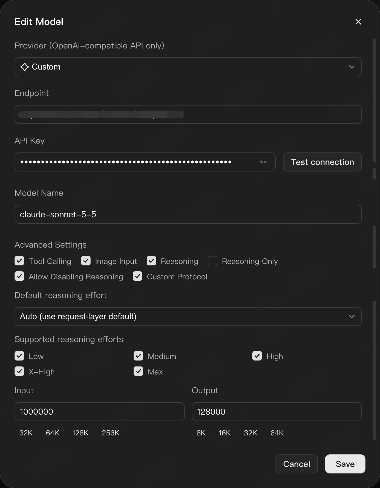
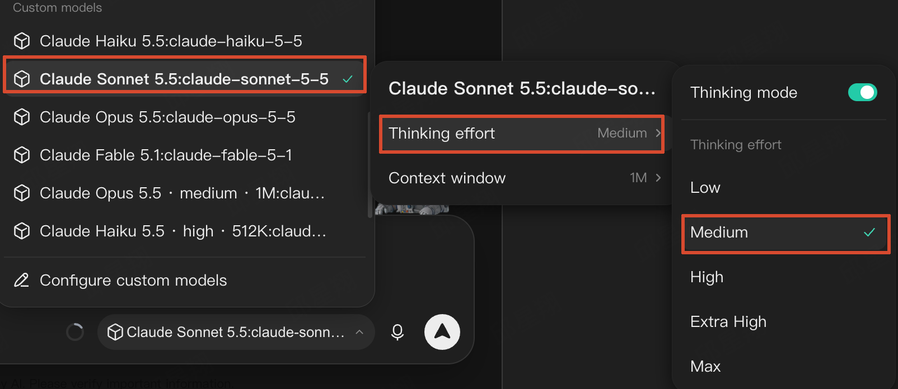
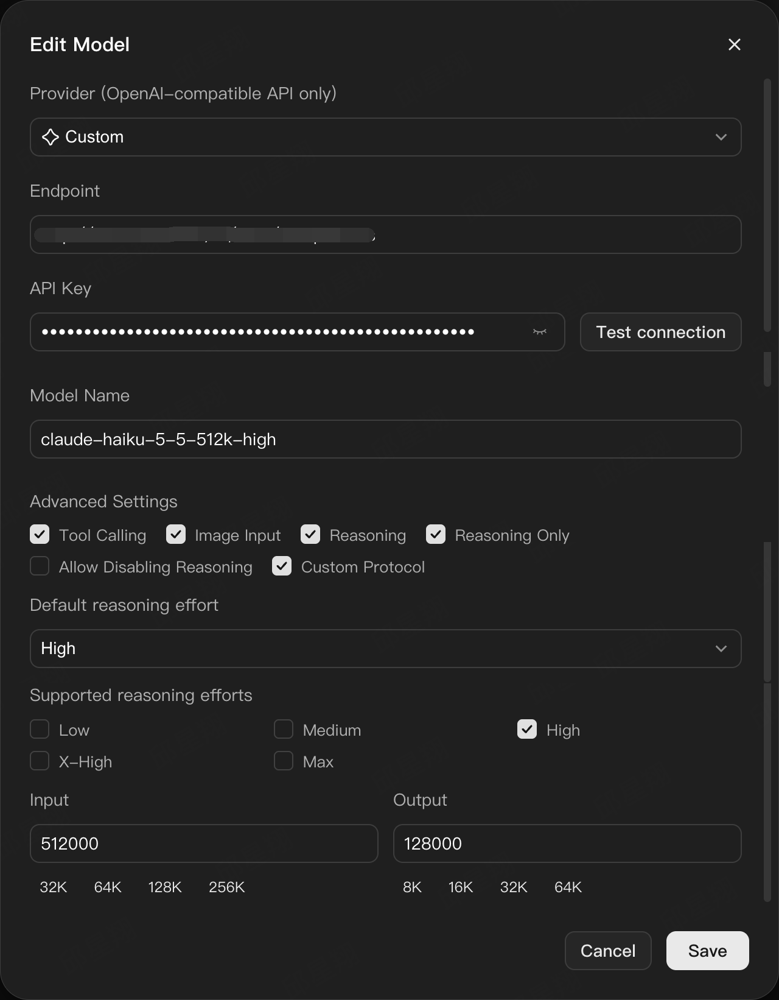
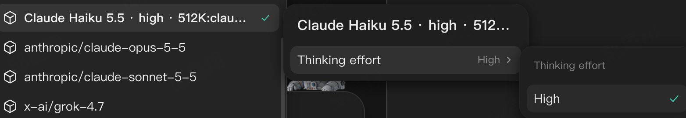

# Using the relay with WorkBuddy

WorkBuddy's model picker can only express what its custom-model entry declares.
This page maps every picker control to a JSON key, then shows two working
recipes — a flexible entry and a pinned preset — with the screenshots from a
real configuration.

The relay itself is a plain OpenAI-compatible endpoint. Nothing below is
relay-specific except the model-id suffix rules.

## 1. Prerequisites

```bash
npm start                 # http://127.0.0.1:8787
curl -s http://127.0.0.1:8787/_health
# {"ok":true,"service":"workbuddy-protocol-relay","version":"..."}
```

WorkBuddy must be able to reach the relay on loopback, and the relay must be
able to reach your Anthropic-compatible upstream (`RELAY_UPSTREAM_HOST`,
`RELAY_UPSTREAM_PATH`).

## 2. Two ways to add a model

| | Flexible entry | Pinned preset |
| --- | --- | --- |
| Model id | `claude-haiku-5-5` | `claude-haiku-5-5-512k-high` |
| Effort source | the picker, sent as `reasoning.effort` | the id suffix, fixed |
| Picker shows | effort row with 5 levels, context row with 3 sizes | effort row with **one** level |
| Use when | you want to choose per conversation | you want one model per preset, no switches |

Both can coexist. A pinned preset is what you use when a client build cannot
send an effort of its own, or when you want the choice to be impossible by
accident.

## 3. Field-by-field mapping

Open **Configure custom models → Add/Edit model**. The dialog is the same
whether you type the JSON by hand or create the entry in the UI.

| Dialog control | JSON key | Notes |
| --- | --- | --- |
| Provider | `vendor: "Custom"` | the relay is not a built-in provider |
| Endpoint | `url` | must be the **full** path: `http://127.0.0.1:8787/v1/chat/completions`. With `useCustomProtocol: true` the client posts to exactly this URL, it does not append `/chat/completions` for you. |
| API Key | `apiKey` | forwarded upstream unchanged; the relay never stores it |
| Model Name | `id` | decoded by the relay: `-<number>k`/`-<number>m` and `-<effort>` are stripped before the request leaves, so `claude-haiku-5-5-512k-high` reaches the upstream as `claude-haiku-5-5` |
| Display name | `name` | free text; put the preset in it (`… · high · 512K`) so the picker is readable |
| Tool Calling | `supportsToolCall` | keep on; agent sessions need it |
| Image Input | `supportsImages` | keep on for vision-capable models |
| Reasoning | `supportsReasoning` | off means the relay sends no `thinking` block at all |
| Reasoning Only | `onlyReasoning` | hides the Thinking on/off switch and shows the model once instead of twice — the right choice for a pinned preset |
| Allow Disabling Reasoning | `canDisableThinking` | checked → `true`. Uncheck it for pinned presets so thinking cannot be switched off |
| Custom Protocol | `useCustomProtocol` | must be `true`; the relay already serves the exact path |
| Default reasoning effort | `reasoning.defaultEffort` | `Auto (use request-layer default)` = omit the key |
| Supported reasoning efforts | `reasoning.supportedEfforts` | the levels the picker offers: `low`, `medium`, `high`, `xhigh`, `max` |
| Input | `maxInputTokens` | client-side budget only, never sent upstream |
| Output | `maxOutputTokens` | the relay clamps `max_tokens` to 128000 |
| — | `contextWindow.supportedLengths` | drives the **Context window** row; an array, e.g. `[200000, 500000, 1000000]` |
| — | `contextWindow.defaultLength` | which length the picker preselects |

Saving in the UI writes the same file the manual edit touches:
`~/.workbuddy/models.json`. Editing the file directly is equivalent, but
WorkBuddy must reload the list (reopen the settings panel or restart) before the
change is visible.

## 4. Recipe A — flexible entry

One entry per model; effort and context are chosen in the picker.



Reading the dialog: Reasoning is on, **Allow Disabling Reasoning** is checked,
**Reasoning Only** is off, Default effort is `Auto`, and all five efforts are
enabled. The JSON behind it:

```json
{
  "id": "claude-sonnet-5-5",
  "name": "Claude Sonnet 5.5",
  "vendor": "Custom",
  "url": "http://127.0.0.1:8787/v1/chat/completions",
  "apiKey": "<YOUR_UPSTREAM_API_KEY>",
  "supportsToolCall": true,
  "supportsImages": true,
  "supportsReasoning": true,
  "useCustomProtocol": true,
  "maxInputTokens": 1000000,
  "maxOutputTokens": 128000,
  "contextWindow": {
    "supportedLengths": [200000, 500000, 1000000],
    "defaultLength": 1000000
  },
  "reasoning": {
    "supportedEfforts": ["low", "medium", "high", "xhigh", "max"]
  }
}
```

The result in the picker — both rows are present and both are switchable:



The relay receives `reasoning.effort` from the picker and turns it into
`thinking: {type: "adaptive"} + output_config: {effort: …}`. Precedence is
**id suffix → `reasoning.effort` → `reasoning_effort` → none**.

## 5. Recipe B — pinned preset

Same upstream model, but one entry per preset: effort and context are baked into
the id and the switches are removed.



Reading the dialog: **Reasoning Only** is checked, **Allow Disabling Reasoning**
is unchecked, Default effort is `High`, and only `High` is enabled. Input is the
pinned budget, `512000`:

```json
{
  "id": "claude-haiku-5-5-512k-high",
  "name": "Claude Haiku 5.5 · high · 512K",
  "vendor": "Custom",
  "url": "http://127.0.0.1:8787/v1/chat/completions",
  "apiKey": "<YOUR_UPSTREAM_API_KEY>",
  "supportsToolCall": true,
  "supportsImages": true,
  "supportsReasoning": true,
  "onlyReasoning": true,
  "useCustomProtocol": true,
  "maxInputTokens": 512000,
  "maxOutputTokens": 128000,
  "contextWindow": {
    "supportedLengths": [512000],
    "defaultLength": 512000
  },
  "reasoning": {
    "defaultEffort": "high",
    "supportedEfforts": ["high"],
    "canDisableThinking": false
  }
}
```

In the picker the entry collapses to a single fixed value — no toggle, no
alternatives:



Because the id carries both markers, this entry is self-describing: even a
client that sends no effort at all gets `high`, and the `512k` marker documents
the budget the entry was sized for.

## 6. Two behaviours that look like bugs but are not

Measured on WorkBuddy's build of 2026-10-24 while writing this page.

**The Context window row disappears when only one length is declared.**
The picker renders that row only when `supportedContextWindows.length >= 2`; the
effort row has a different predicate and does appear with a single level. So a
pinned preset legitimately shows *Thinking effort → High* and no context row,
which is exactly what the fourth screenshot shows. The budget is still applied
(`maxInputTokens`), it is simply displayed in the model title (`… · 512K`)
instead of a selector. Declare two or more lengths if you want the row back.

**The effort row stays visible with one level.** This is the intended way to
show a preset: the value is visible, and it cannot be changed. Do not add extra
efforts just to make the list look populated — the relay would then honour a
choice the entry was not sized for.

## 7. Verify the whole path

```bash
# what the relay decoded from the id, and what it sent upstream
RELAY_DUMP=1 npm start

curl -s http://127.0.0.1:8787/v1/chat/completions \
  -H 'Authorization: Bearer <YOUR_UPSTREAM_API_KEY>' \
  -H 'Content-Type: application/json' \
  -d '{"model":"claude-haiku-5-5-512k-high","stream":false,
       "messages":[{"role":"user","content":"say ok"}]}'
```

The dump line reports the decoded model, effort and `max_tokens`. If the effort
is missing there, the id suffix was not recognised — check the spelling against
`src/model-id.mjs` (`-<number>k|-<number>m` then `-<low|medium|high|xhigh|max>`).

Failures that point at the client rather than the relay:

| Symptom | Likely cause |
| --- | --- |
| `404` on every request | `url` is the base (`http://127.0.0.1:8787/v1`) instead of the full path, and `useCustomProtocol` is on |
| Empty-looking stream | the client is talking to `/v1/messages` directly instead of the relay |
| Effort always ignored | `reasoning.supportedEfforts` missing → the picker sends nothing |
| Model appears twice (with and without thinking) | set `onlyReasoning: true` for a pinned preset |
